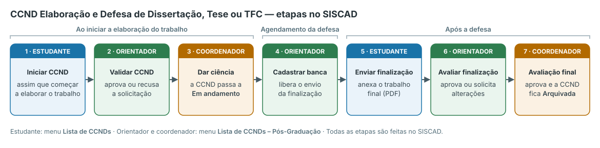
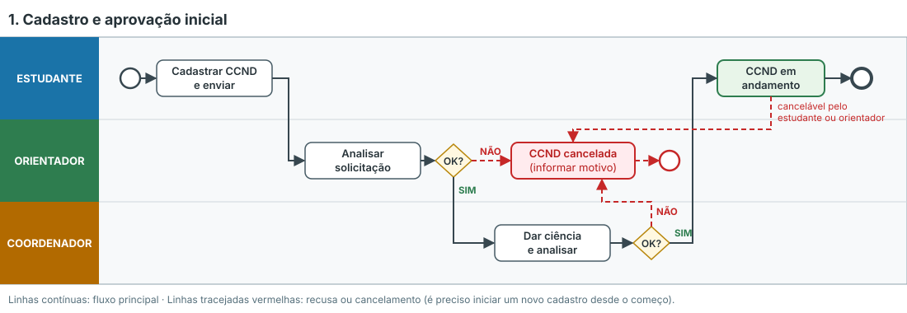
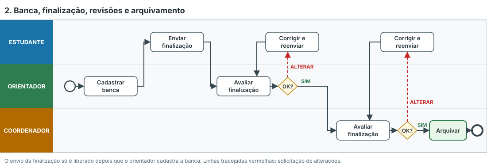

# CCNDs no SISCAD

> Baseado nas **Orientações sobre CCND** e no **Tutorial CCND — Elaboração e Defesa de Dissertação, Tese ou Trabalho Final de Curso (TFC)**, da SEAAR/DIPOS/PROPP, e na **Resolução nº 1.035/2025-COPP/UFMS**.

## O que são as CCNDs

Os **Componentes Curriculares Não Disciplinares (CCNDs)** são atividades da pós-graduação que não são disciplinas. Segundo a Res. nº 1.035/2025-COPP, elas são desenvolvidas sob a forma de:

1. Atividades especiais
2. Elaboração e defesa de Dissertação, Tese ou Trabalho Final de Curso (TFC)
3. Exame de Qualificação
4. Desenvolvimento de pesquisa
5. Atividades Orientadas de Ensino
6. Estágio

No **PPGCC**, a estrutura curricular adota quatro dessas formas: **Atividades Orientadas de Ensino** (Estudos Dirigidos), **Exame de Qualificação**, **Elaboração e Defesa de Dissertação ou Tese** e **Estágio** (art. 22, § 2º, da Res. nº 1.212/2026).

::: info Sem matrícula, nota ou frequência
Segundo a orientação da PROPP, as CCNDs **não exigem matrícula, registro de notas ou frequência**. É necessário apenas **registrar o início** da atividade e **encaminhar os documentos comprobatórios** pertinentes a cada CCND. Para o Estágio de Docência, a Res. nº 1.035/2025 prevê requerimento de matrícula com plano de trabalho e registro no histórico (art. 83, §§ 4º e 9º).
:::

## Situação no SISCAD

As CCNDs estão em fase de implementação no SISCAD.

| CCND | No SISCAD |
|---|---|
| Elaboração e defesa de Dissertação, Tese ou TFC | ✅ Disponível |
| Demais CCNDs (qualificação, estágio, atividades orientadas de ensino etc.) | ⏳ Em implementação |

Enquanto a funcionalidade não existir no SISCAD, a atividade **pode ser realizada normalmente**: o estudante encaminha a documentação comprobatória ao Programa, e **o PPG e o estudante mantêm esses documentos arquivados** em seus controles internos para registro posterior no SISCAD.

::: warning Cadastro ativo
Para registrar a CCND, o cadastro do estudante precisa estar **ativo**. Se houver ocorrência de **Concluinte (CON)** ou **Apto para Diplomação (APT)**, ela deve ser removida e adicionada novamente após a conclusão da CCND.
:::

---

## CCND do trabalho final: visão geral

A CCND **Elaboração e Defesa de Dissertação, Tese ou TFC** acompanha o trabalho final do início da escrita até o depósito da versão final. Ela envolve três papéis: **estudante**, **orientador** e **coordenador**.

| # | Quando | Quem | O que fazer no SISCAD |
|---|---|---|---|
| 1 | Ao **iniciar** a elaboração do trabalho | Estudante | Registrar o início da CCND |
| 2 | Logo após o envio | Orientador | Validar (aprovar) a CCND |
| 3 | Após a aprovação do orientador | Coordenador | Dar ciência — a CCND fica **Em andamento** |
| 4 | No **agendamento da defesa** | Orientador | Cadastrar a banca de defesa |
| 5 | **Após a defesa** | Estudante | Anexar o trabalho final (envio da finalização) |
| 6 | Após o envio | Orientador | Aprovar ou solicitar alterações |
| 7 | Após a aprovação do orientador | Coordenador | Avaliação final — a CCND é **Arquivada** |

Onde fica no SISCAD:

- **Estudante:** menu **Lista de CCNDs**
- **Orientador e coordenador:** menu **Lista de CCNDs – Pós-Graduação**

---

## Fase 1 — Cadastro e aprovação inicial

### Estudante: iniciar a CCND

1. No SISCAD, acesse **Lista de CCNDs** e clique em **+ Iniciar CCND**.
2. Selecione o tipo **Elaboração e Defesa de Dissertação, Tese ou Trabalho Final de Curso** e clique em **Continuar**.
3. Preencha os dados iniciais: **Título**, **Resumo**, **Previsão de início** e **Previsão de término**.
4. Clique em **Salvar Rascunho**. O rascunho **ainda não é enviado** ao orientador e pode ser visualizado, editado ou apagado.
5. Na visualização ou na edição, clique em **Enviar para aprovação** e confirme.

Depois do envio, a situação passa para **Aguardando aceite do orientador** e os dados não podem mais ser alterados pelo estudante.

### Orientador: analisar a solicitação

1. Acesse **Lista de CCNDs – Pós-Graduação** e clique em **Visualizar** na CCND do estudante.
2. Escolha uma das opções:
   - **Aprovar**: a situação passa para **Aguardando ciência do coordenador**.
   - **Recusar**: informe o **motivo da recusa**. A CCND fica **Cancelada** para o orientador e para o estudante, que pode consultar o motivo na visualização.

### Coordenador: dar ciência

1. Acesse **Lista de CCNDs – Pós-Graduação** e clique em **Visualizar**.
2. Escolha uma das opções:
   - **Aprovar**: a CCND passa para **Em andamento**.
   - **Recusar**: informe o motivo. A CCND é **Cancelada**.

::: danger Recusa ou cancelamento
Uma CCND cancelada **não é reaproveitada**: o estudante precisa **iniciar um novo cadastro desde o começo**.
:::

---

## Durante o andamento

| Papel | O que pode fazer com a CCND **Em andamento** |
|---|---|
| **Estudante** | Visualizar ou **cancelar** (informando o motivo). O envio da finalização fica **bloqueado** até o orientador cadastrar a banca. |
| **Orientador** | Visualizar, **editar os dados básicos** do trabalho, **cadastrar a banca** ou **cancelar** (informando o motivo). |
| **Coordenador** | Apenas **visualizar** os dados da CCND e do trabalho. |

### Orientador: cadastrar a banca

No período de agendamento da defesa, o orientador abre **Cadastrar banca** e clica em **Novo Docente** para cada integrante:

1. Informe se o membro é **docente da UFMS** ou **externo**.
2. Pesquise o membro pelo nome.
3. Indique se ele atuará como **presidente**, **suplente** ou **coorientador**.
4. Clique em **Salvar**. O membro passa a aparecer na listagem da banca.

As regras de composição da banca estão em [Defesa de Dissertação ou Tese](./defesa#composicao-da-banca-examinadora) e em [Bancas Examinadoras](../docentes/bancas).

---

## Fase 2 — Finalização, revisões e arquivamento

### Estudante: enviar a finalização (após a defesa)

Com a banca cadastrada, a tela de **envio da finalização** é liberada. Ela mostra a banca de avaliação e pede:

| Campo | Observação |
|---|---|
| Título | Obrigatório |
| Abstract | Obrigatório |
| Resumo | Obrigatório |
| Tipo de documento | Preenchido pelo sistema (dissertação ou tese) |
| Área do conhecimento | Obrigatório |
| Palavras-chave | Obrigatório |
| Pode ser acessado publicamente? | Marque se o trabalho pode ter acesso público |
| Trabalho final | Arquivo do trabalho (obrigatório) |

Clique em **Enviar para aprovação** e confirme. A situação passa para **Enviado ao orientador**.

### Orientador: avaliar a finalização

Na listagem aparece um novo botão para **avaliar o envio**, com os dados informados e o trabalho anexado.

- **Aprovar finalização**: a CCND segue para o coordenador.
- **Solicitar alterações**: escreva uma mensagem explicando o que precisa ser corrigido. A situação passa para **Revisão solicitada pelo orientador**.

### Estudante: corrigir e reenviar

Quando houver **Revisão solicitada**, abra novamente a tela de envio da finalização, leia a mensagem com as alterações pedidas, corrija e **envie de novo para aprovação**.

### Coordenador: avaliação final

O coordenador recebe a CCND aprovada pelo orientador e pode consultar os dados e o trabalho anexado.

- **Aprovar finalização**: a CCND passa a **Arquivada** para coordenador, orientador e estudante, **concluindo o fluxo**.
- **Solicitar alterações**: o estudante corrige e reenvia, no mesmo fluxo usado para a revisão do orientador.

---

## Situações da CCND

| Situação | Significado | Próximo passo |
|---|---|---|
| **Rascunho** | Salva, mas não enviada | Estudante envia para aprovação |
| **Aguardando aceite do orientador** | Enviada pelo estudante | Orientador aprova ou recusa |
| **Aguardando ciência do coordenador** | Aprovada pelo orientador | Coordenador aprova ou recusa |
| **Em andamento** | Trabalho em elaboração | Orientador cadastra a banca; após a defesa, estudante envia a finalização |
| **Enviado ao orientador** | Finalização enviada | Orientador aprova ou solicita alterações |
| **Revisão solicitada** | Orientador ou coordenador pediu correções | Estudante corrige e reenvia |
| **Arquivada** | Finalização aprovada pelo coordenador | Fluxo concluído |
| **Cancelada** | Recusada ou cancelada, com motivo | Iniciar um novo cadastro |

---

## Dúvidas

- Tutorial com as telas do sistema: aba **Tutoriais para registro de CCND** na página **SISCAD Mestrado e Doutorado** do [Portal de Orientações e Procedimentos da Propp](https://propp.ufms.br/).
- **SEAAR/DIPOS/PROPP** (Secretaria de Avaliação, Acompanhamento e Regulação) — ramais **7198** e **3977**, e-mail [seaar.propp@ufms.br](mailto:seaar.propp@ufms.br).
